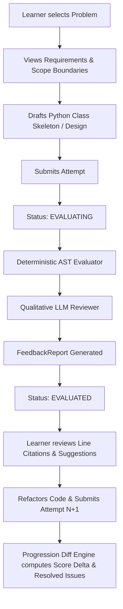

# Design Note: Architecture of the LLD Practice Platform

## 1. Overview & MVP Scope

The LLD Practice Platform is a lightweight, single-process monolith designed to simulate an expert LLD technical interviewer. It evaluates object-oriented designs submitted by learners, highlights anti-patterns (such as God classes and missing domain abstractions) with line-level precision, and guides iterative refactoring across attempts.

The MVP strictly avoids distributed infrastructure (microservices, message brokers, external databases). All domain behavior, static analysis, and progression tracking run locally in standard Python 3.10+ with zero external package dependencies.

---

## 2. Core User Flow



---

## 3. Domain Model & Responsibilities

The domain is partitioned into single-responsibility components:

| Class / Interface | Responsibility |
| :--- | :--- |
| **`Problem`** | Holds problem metadata, problem statements, scope boundaries, and the `EvaluationSpec` containing required entities, operations, and thresholds. |
| **`Submission`** | Value object encapsulating submitted source code, rationale notes, submission format, and timestamp. |
| **`Attempt`** | Aggregate root tracking the lifecycle of an attempt (`DRAFT` ➔ `SUBMITTED` ➔ `EVALUATING` ➔ `EVALUATED` or `FAILED`), its associated report, and error messages. |
| **`Evaluator` (Interface)** | Contract for evaluation engines: `evaluate(submission, problem, attempt_id) -> FeedbackReport`. |
| **`EvaluationRule` (Interface)** | Open/Closed extension point for AST-level static checks. Implementing classes include `SyntaxValidationRule`, `RequiredEntitiesRule`, `GodClassRule`, `RequiredOperationsRule`, and `RelationshipCompositionRule`. |
| **`DeterministicEvaluator`** | Builds `EvaluationContext` via Python `ast.parse` and coordinates the execution of registered `EvaluationRule` instances. |
| **`LLMReviewer` (Interface)** | Contract for qualitative review: `review(submission, problem, deterministic_result) -> QualitativeReview`. Decouples AI generation from the core pipeline. |
| **`EvaluationPipeline`** | Composite evaluator orchestrating deterministic checks and qualitative review. Implements timeout isolation so AI timeouts never crash the attempt. |
| **`ProgressionSummary`** | Value object representing the diff between Attempt $N-1$ and Attempt $N$, tracking score delta, resolved issues, and persisting warnings. |
| **`AttemptRepository` (Interface)** | Storage abstraction (`save`, `get_by_id`, `list_by_learner_and_problem`). Implemented as thread-safe `InMemoryAttemptRepository`. |
| **`PlatformService`** | Application service coordinating user workflows: starting attempts, evaluating submissions, error handling, retrying failed attempts, and calculating progression. |

---

## 4. Evaluation Strategy: Deterministic vs. LLM

### Why Split Evaluation?
Relying entirely on an LLM for code grading suffers from non-determinism, hallucinations, and an inability to reliably count methods or enforce rigid interview constraints. Conversely, purely deterministic unit testing tests runtime output rather than design quality.

Our architecture splits the workload:

```
                                 [ Submission Code ]
                                          │
                     ┌────────────────────┴────────────────────┐
                     ▼                                         ▼
         Deterministic AST Engine                    Qualitative LLM Reviewer
     ───────────────────────────────            ───────────────────────────────────
     • Syntax validation                        • Design pattern critique (Strategy/State)
     • Required entity presence                 • Extensibility vs over-engineering
     • God class threshold (SRP)                • Concurrency & thread-safety warnings
     • Required operations coverage             • Actionable refactoring advice
     • Composition / relationship checks
                     │                                         │
                     └────────────────────┬────────────────────┘
                                          ▼
                               [ Unified FeedbackReport ]
```

### Deterministic Rule Engine
The AST analyzer extracts `ClassInfo` (methods, line numbers, assigned attributes on `self`, base classes, docstrings). Rules run in sequence:
- **`GodClassRule`**: If a class exceeds `god_class_method_threshold` (e.g. 7 methods in `ParkingLot`), it issues a `WARNING` with exact line numbers and suggests decomposing auxiliary responsibilities.
- **`RequiredEntitiesRule`**: Detects if core domain objects (e.g., `ParkingTicket`, `PricingStrategy`) are absent.
- **`RequiredOperationsRule`**: Verifies that business methods (e.g., `park_vehicle`, `calculate_fee`) exist across defined classes.

### LLM Reviewer Interface & Defensive Fallback
The `LLMReviewer` interface is implemented by `StubbedLLMReviewer` for zero-setup, deterministic test runs, and can be swapped for an OpenAI-compatible provider.
If the LLM reviewer times out or fails with a network exception, `EvaluationPipeline` intercepts the failure, preserves the deterministic findings, and sets a helpful fallback note rather than failing the attempt.

---

## 5. Extensibility (Open/Closed Principle)

The design allows adding new rules and submission formats without modifying existing code:

1. **Adding an Evaluation Rule**:
   Create a class implementing `EvaluationRule` and register it with `evaluator.add_rule(MyNewRule())`. Existing rules remain untouched (see [`tests/test_extensibility.py`](file:///C:/Users/sanat/.gemini/antigravity-ide/scratch/lld-practice-platform/tests/test_extensibility.py)).
2. **Adding an LLM Provider**:
   Create a class implementing `LLMReviewer` (e.g., `AnthropicReviewer` or `OpenAIReviewer`) and pass it to `EvaluationPipeline(llm_reviewer=...)`.
3. **Pluggable Persistence**:
   Swap `InMemoryAttemptRepository` with `FileAttemptRepository` or `SqliteAttemptRepository` via dependency injection in `PlatformService`.

---

## 6. Failure & Timeout Handling

- **Evaluation Timeout**: Handled inside `EvaluationPipeline` using `concurrent.futures.ThreadPoolExecutor(max_workers=1)` with a configurable timeout. If the LLM review times out, the deterministic evaluation report is returned immediately.
- **Catastrophic Failure**: If an unhandled exception or memory error occurs, `PlatformService` intercepts the error, transitions the `Attempt` to `FAILED`, persists the diagnostic message, and exposes `retry_attempt(attempt_id)` so the learner can retry without starting over.

---

## 7. Scaling Considerations (Future Path)

While designed as a clean monolith, scaling to thousands of concurrent learners would involve:
1. **Asynchronous Task Queue**: Transitioning `EvaluationPipeline.evaluate()` to a background worker queue (e.g. Celery / Redis or BullMQ) to avoid blocking web request workers during slow AI calls.
2. **Repository Layer**: Swapping `InMemoryAttemptRepository` for PostgreSQL with an indexed schema (`learner_id`, `problem_id`, `created_at`).
3. **AST Sandboxing**: Executing untrusted user code or AST visitors in isolated worker runtimes or lightweight Linux containers.
